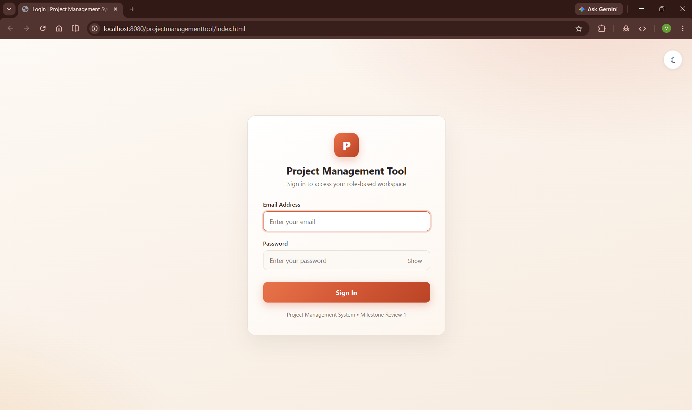
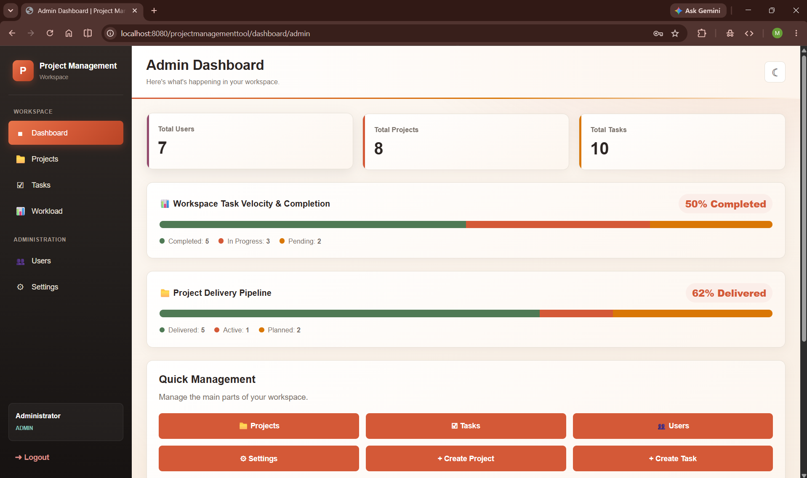
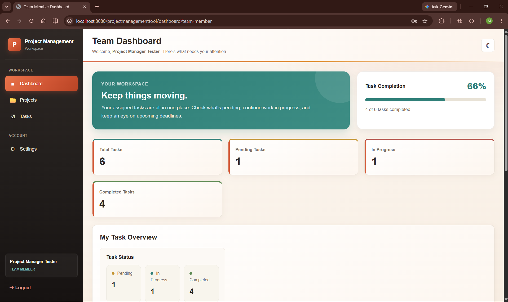
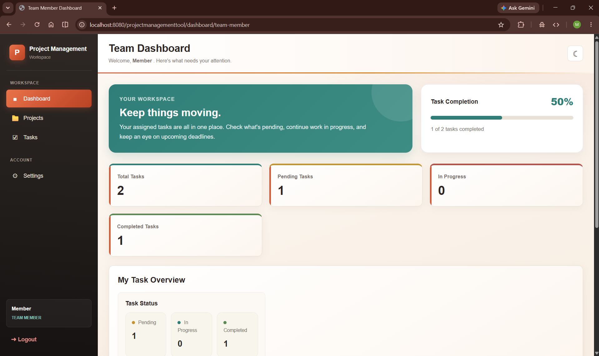

<h1 align="center">Project Management System</h1>

<p align="center">
  A web app to manage projects and tasks in a team, with separate dashboards for admin, project manager and team member.
</p>

<p align="center">
  
  
  
  
  
  
</p>

---

## Contents

- [About](#about)
- [Screenshots](#screenshots)
- [Features](#features)
- [Tech stack](#tech-stack)
- [Folder structure](#folder-structure)
- [Database](#database)
- [How to run](#how-to-run)
- [Test logins](#test-logins)
- [Planned for Review 2](#planned-for-review-2)

## About

Most small teams keep track of their work in chats and sheets, and things get lost. This project puts it all in one place. Admins set up users and projects, project managers break projects into tasks and give them to people, and team members update their tasks as they work.

It is built with Java servlets and JSP on the backend, MySQL for the data, and runs on Tomcat. This repo is the **Review 1** version.

## Screenshots

<table>
  <tr>
    <td align="center"><b>Login</b><br></td>
    <td align="center"><b>Admin dashboard</b><br></td>
  </tr>
  <tr>
    <td align="center"><b>Project manager dashboard</b><br></td>
    <td align="center"><b>Team member dashboard</b><br></td>
  </tr>
</table>

## Features

| Role | What they can do |
|---|---|
| Admin | Add, edit and delete users, projects, tasks and system settings. Sees overall numbers on the dashboard |
| Project manager | Manages their own projects, creates tasks, assigns them and checks each person's workload |
| Team member | Sees assigned tasks, updates the status (pending, in progress, completed) and comments on tasks |

Other things:
- Login and logout with sessions
- Task priority (low to urgent), due dates and assignee
- Profile page and personal preferences (landing page, hide completed tasks)
- Dark and light theme

**Security**
- Passwords are hashed with jBCrypt
- CSRF token check on every form that changes data
- A filter sends you back to login if you open a dashboard page without signing in
- PreparedStatements in all DAO classes, so no SQL injection
- Output is escaped to stop XSS
- The database login comes from environment variables and is not written in the code

## Tech stack

| Part | Used |
|---|---|
| Language | Java 17 |
| Web | Jakarta Servlet 5, JSP, HTML, CSS, JavaScript |
| Server | Apache Tomcat 10.1 |
| Database | MySQL (XAMPP), JDBC |
| Security | jBCrypt |
| Build tool | Maven |

## Folder structure

```
projectmanagementtool
├── database          schema.sql, sample_data.sql and the migration files
├── src/main/java/com/pms
│   ├── controller    servlets
│   ├── dao           database code
│   ├── model         User, Project, Task, Comment...
│   ├── filter        login check and CSRF check
│   ├── service       CrudService, HeartbeatService
│   └── util          DBConnection, PasswordUtil, HtmlUtil...
├── src/main/webapp   login page, css and the JSP pages in dashboard/
├── docs/screenshots  images used in this README
├── start-pms.bat     starts everything on Windows
├── stop-pms.bat      stops it
└── pom.xml
```

## Database

There are 6 tables: `users`, `projects`, `tasks`, `system_settings`, `task_comments` and `user_preferences`.

- a project has a manager (a user)
- a task belongs to a project and can be assigned to a user
- comments belong to a task and to the user who wrote them
- every user has one row of preferences

The full script is in [`database/schema.sql`](database/schema.sql).

## How to run

**You need:** JDK 17, Tomcat 10.1 (Tomcat 9 will not work because of the jakarta packages), XAMPP for MySQL, and Maven (IntelliJ already has one inside).

### Easy way (Windows)

1. Open `start-pms.bat` and check that the Tomcat and XAMPP paths at the top match your computer.
2. Double click it.

It starts MySQL, creates the database if it is missing, builds the project, puts it in Tomcat and opens the browser. Use `stop-pms.bat` to shut it down.

### Manual way

1. Start MySQL from the XAMPP control panel.
2. Run `database/schema.sql` and then `database/sample_data.sql`.
3. Run `mvn clean package`.
4. Copy `target/projectmanagementtool-1.0-SNAPSHOT.war` into Tomcat's `webapps` folder and rename it to `projectmanagementtool.war`.
5. Start Tomcat and open http://localhost:8080/projectmanagementtool/

### Database settings

By default the app connects to `jdbc:mysql://localhost:3306/pms_db` as `root` with no password, which is what XAMPP gives you. If yours is different, set these environment variables before starting Tomcat:

`PMS_DB_URL`, `PMS_DB_USER`, `PMS_DB_PASSWORD`

## Test logins

| Role | Email | Password |
|---|---|---|
| Admin | admin@pms.com | admin123 |
| Project manager | manager@pms.com | manager123 |
| Team member | john@pms.com | member123 |
| Team member | sarah@pms.com | member123 |

## Planned for Review 2

- Kanban board for tasks
- Charts on the dashboards
- File attachments on tasks
- Activity log
